<div align="center">

# ◆ rote

**Muscle memory for coding agents.**

How many times have you paid your agent to figure out how to run your tests?<br>
Rote finds out, then teaches it once so the next time costs nothing.



<sub>Recorded on the synthetic sample transcripts in <a href="examples/">examples/</a>, not real usage data.</sub>

```bash
npx rote-cli stats
```

100% local · zero config · zero dependencies · no API key · reads your transcripts in under a second

📖 **New to rote? Read the [Guide](GUIDE.md)**: every command, a 5-minute walkthrough, and FAQ.

</div>

---

## The problem

Every new agent session starts from zero. Before your agent can run your tests, it reads
`package.json`, tries `npm test`, finds out the suite lives in `web/`, tries `npx vitest`
(watch mode, hangs), and finally lands on `cd web && npx vitest run`.

Next session, it does the same thing again, **and you pay for every one of those turns.**
Each turn re-reads the whole context window, so a "quick" three-turn detour on a large
project can cost more than the work you actually asked for.

## What rote does

**1. `rote stats`: see what your agent keeps rediscovering.**

Rote reads the session transcripts your agent already keeps on disk
(`~/.claude/projects/` for Claude Code). It finds commands that worked in several sessions,
and measures what each session spent exploring and retrying before it got there.

```
  ◆ rote  muscle memory for coding agents
  Scanned 16 Claude Code sessions · 418 turns · 3 projects in 0.03s

     #  PATTERN                                  PROJECT             SEEN  AVG TURNS   TOKENS     WASTED
     1  Run tests   vitest run · apps/web/       acme-storefront       6×        3.3     1.8M      $0.93
     2  Run tests   pytest                       billing-api           5×        2.8     1.1M      $0.60
     3  Type-check  tsc                          acme-storefront       3×        2.7     711k      $0.35
     4  Dev server  uvicorn                      billing-api           2×        2.5     322k      $0.15
     5  Lint        make lint                    edge-gateway          3×        2.0     330k      $0.12

  $2.15  spent figuring out commands your agent had already gotten working before
         17 rediscoveries · 4.3M tokens · 15m of agent time · 9.4% of $22.99 total agent spend
```

<sub>Output on the sample transcripts. Your numbers come from your own history.</sub>

**2. `rote show <id>`: see the evidence.** Every number comes from a real session. Rote
shows you which turns it counted:

```
  2026-09-02  agent-a9  2 turns  $0.02  (subagent)
     · Read review-system/wrangler.toml
     · Read review-system/package.json
     ✓ cd review-system && npx wrangler dev --local --persist-to .wrangler/state --port 8787
```

**3. `rote learn <id>`: compile it into a skill.** Rote writes a
[Claude Code skill](https://code.claude.com/docs/en/skills) with the command that worked:

```
.claude/skills/dev-wrangler-review-system/
├── SKILL.md    # tells the agent: "this is the verified command, don't explore"
└── run.sh      # cd review-system && npx wrangler dev --local ... "$@"
```

Next session, the agent sees the skill, runs it in one call, and skips the exploring.

## Before and after

Measured on real sessions from the author's own Claude Code history: the three times the agent
(Claude Sonnet 5) re-worked out how to start `wrangler dev` for a Cloudflare Workers project.

|                                | As it happened   | With a learned skill |
| ------------------------------ | ---------------- | -------------------- |
| Turns to a running dev server  | 2 per session    | 1                    |
| Tokens (3 sessions)            | 2.45M            | 1.22M                |
| API-equivalent cost (3 sessions) | $0.51          | $0.26                |

"With a learned skill" keeps only the final working call, since a skill call replaces the
exploration but still takes a turn. It's a small project, so the dollar figures are small. The
saving grows with context size and with how many times the agent has to rediscover something.
`rote show` prints the exact turns behind numbers like these, so you can check any of them.

### Try it without your own history

```bash
git clone https://github.com/atharva283/rote-cli && cd rote-cli
npm install && npm run build
node dist/cli.js stats --transcripts examples/transcripts
```

## Install

```bash
npx rote-cli stats           # run without installing
npm i -g rote-cli            # or install the `rote` command
```

Requires Node 18.17+. Works on macOS, Linux and Windows (bash and PowerShell sessions).

## Commands

```
rote stats [project-path]      what your agent keeps paying to rediscover
rote show <id>                 the sessions behind one pattern
rote learn [id] [--dry-run]    compile patterns into one-call agent skills
```

| Option                | Description                                                     |
| --------------------- | --------------------------------------------------------------- |
| `--limit <n>`         | rows to show (default 10)                                       |
| `--all`               | include patterns the agent always got right first time          |
| `--min <n>`           | minimum sessions before something counts as a pattern (default 2) |
| `--project <path>`    | restrict `learn`/`show` to one project                          |
| `--transcripts <dir>` | read transcripts from somewhere other than `~/.claude/projects` |
| `--dry-run`           | print skill files instead of writing them                       |
| `--force`             | overwrite skills that already exist                             |
| `--json`              | machine-readable output                                         |

`rote learn` with no id learns every safe pattern in the current project.

See the **[Guide](GUIDE.md#-command-reference)** for every option, with sample output,
JSON format, environment variables, and error messages.

## How it counts

Rote errs on the side of **under-counting**. These rules are deliberately strict, so the
number it shows is a floor:

- **A turn** is one model API call. Its cost is the actual token usage recorded in the
  transcript (input, output, cache reads, and 5-minute and 1-hour cache writes), priced at
  Anthropic list prices. On sessions that weren't resumed, this matches Claude Code's own
  recorded cost to the cent.
- **A rediscovery** is the run of turns right before a command succeeded, where the agent was
  only looking around: listing directories, reading `package.json`/`pyproject.toml`/CI
  config, running `--help`, or retrying the same kind of command after it failed.
- **Real work is never counted.** If the agent edited a file, read source code, or ran
  an unrelated command, the window stops there. A test that fails, gets fixed, then passes
  counts as zero waste, because that's TDD, not rediscovery.
- **Waste** is every turn in that window except the final working one, since a skill call
  still takes one turn.
- **Subscription users:** dollar figures are what the same tokens would cost on the API.

## Safety

`rote learn` only writes files inside your project's `.claude/skills/`. It never runs
anything. Recipes are filtered before they become skills:

- Destructive steps are stripped, or the pattern is refused: `rm`, `git push`,
  `reset --hard`, `--force`, `DROP TABLE`, `sudo`, `kill`, `curl | sh`, and more.
- Reset and clean scripts (`npm run seed:reset`, `make clean`, `db:drop`, ...) are refused.
- Deploys and publishes (`wrangler deploy`, `npm publish`, `terraform apply`, ...) are never
  learned.
- Recipes that contain anything that looks like a secret (API keys, tokens, `PASSWORD=`) are
  refused, and secrets are masked as `***` everywhere rote prints a command.

Use `--dry-run` to read every file before it's written. Skills are plain Markdown and a
shell script, so they're easy to review and commit.

## Privacy

Rote makes no network calls, collects no telemetry, and never sends your transcripts anywhere.
It reads files on your disk and prints a table.

## Supported agents

| Agent       | Transcripts | Skills                 |
| ----------- | ----------- | ---------------------- |
| Claude Code | ✅          | `.claude/skills/`      |
| Codex CLI   | planned     | planned                |
| Aider       | planned     | `CONVENTIONS.md`       |
| Cursor      | planned     | `.cursor/rules/`       |

Adding an agent means implementing one interface, `ITranscriptAdapter` in
[`src/types.ts`](src/types.ts). See [`src/adapters/claude-code.ts`](src/adapters/claude-code.ts)
for the reference implementation. PRs welcome.

## Development

```bash
git clone https://github.com/atharva283/rote-cli && cd rote-cli
npm install
npm test                     # builds, then runs the test suite
node dist/cli.js stats       # run against your own transcripts
npm run demo                 # regenerate examples/ and assets/demo.svg
```

## License

MIT © Atharva
